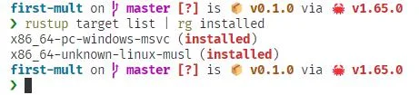
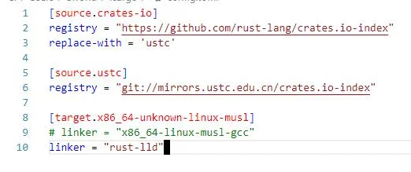
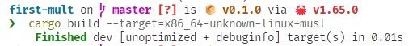
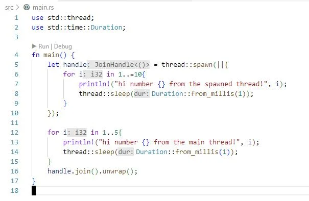
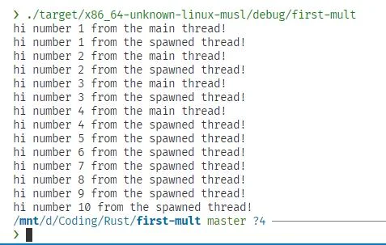

最近在尝试在 Windows11 下编译 Linux 可用的程序时遇到了不少问题，我这里总结一个简单的编译方法供大家参考(不过现在都有WSL了，是不是直接在上面编译更好?)

# 具体方法

## 安装工具链

`rustup target add x86_64-unknown-linux-musl` 使用 musl 进行静态连接工具链
你可以使用`rustup target list`指令来检查自己是否装好了工具链


## 修改 Cargo 配置

在 ~/.cargo/config.toml (如果没有请自己创建) 内加上

```toml
[target.x86_64-unknown-linux-musl]
linker = "rust-lld"
```



## 进行编译和测试

使用`cargo build --target=x86_64-unknown-linux-musl`就可以进行编译你的项目了，或者也可以用`cargo build --target x86_64-unknown-linux-musl --release`来构建 release 模式的

可见，很快就编译好了，下面我使用 WSL2 运行该程序测试正确性，代码如下(虽然这个不重要)

运行结果如下

可见，一切顺利，结束！
