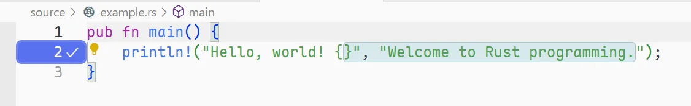
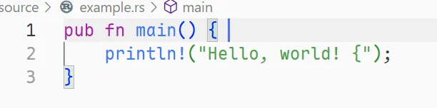
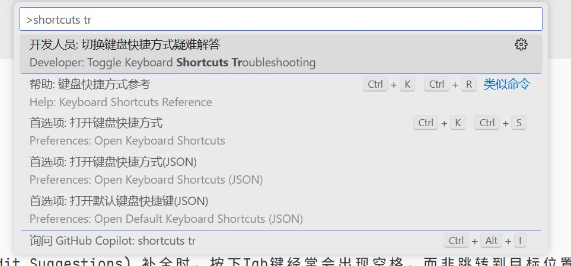
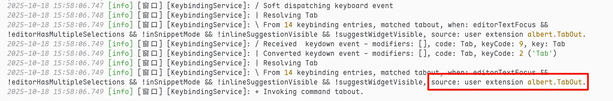
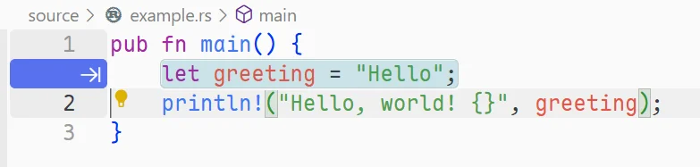
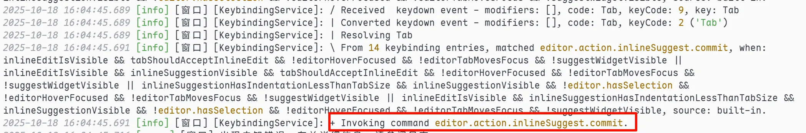

相关：[GitHub Copilot](../../not-public)、[VSCode](../../not-public)

近期在使用Github Copilot时，发现在面对 NES(Next Edit Suggestions) 补全时，按下Tab键经常会出现空格，而非跳转到目标位置，经过一番排查，发现这是因为VSCode的Tab键绑定冲突导致的，本文记录下解决方法。

## 错误表现

在使用Github Copilot进行代码补全时，按下Tab键并没有跳转到补全建议的位置，而是插入了空格，导致无法顺利接受补全建议，如下图：




## 调试思路

首先我们启动VSCode的键盘快捷键调试功能，按下`Ctrl + Shift + P`搜索`shortcut troubleshooting`，打开快捷键调试面板。



发现类似下方的信息：



```log
2025-10-18 15:58:06.749 [info] [窗口] [KeybindingService]: / Received  keydown event - modifiers: [], code: Tab, keyCode: 9, key: Tab
2025-10-18 15:58:06.749 [info] [窗口] [KeybindingService]: | Converted keydown event - modifiers: [], code: Tab, keyCode: 2 ('Tab')
2025-10-18 15:58:06.749 [info] [窗口] [KeybindingService]: | Resolving Tab
2025-10-18 15:58:06.749 [info] [窗口] [KeybindingService]: \ From 14 keybinding entries, matched tabout, when: editorTextFocus && !editorHasMultipleSelections && !inSnippetMode && !inlineSuggestionVisible && !suggestWidgetVisible, source: user extension albert.TabOut.
2025-10-18 15:58:06.749 [info] [窗口] [KeybindingService]: + Invoking command tabout.
```

显然，Tab键被`TabOut`插件占用了。

## 解决方法

此时我们可以使用`Ctrl + K Ctrl + S`打开键盘快捷键设置，搜索`"Tab"`，找到`TabOut: Tab Out`，点击右侧的垃圾桶图标删除该快捷键绑定。

不过也有更好的办法，就是为 `TabOut`插件设置一个条件，使其在Github Copilot补全建议出现时不生效。我们可以将其`when`条件末尾追加`!inlineEditIsVisible`条件，最终得到该条件`editorTextFocus && !editorHasMultipleSelections && !inSnippetMode && !inlineSuggestionVisible && !suggestWidgetVisible && !inlineEditIsVisible` （编辑后按回车保存）。

现在，就能够正常补全了：





结束后重新按下`Ctrl + Shift + P`搜索`shortcut troubleshooting`以关闭快捷键调试面板。
