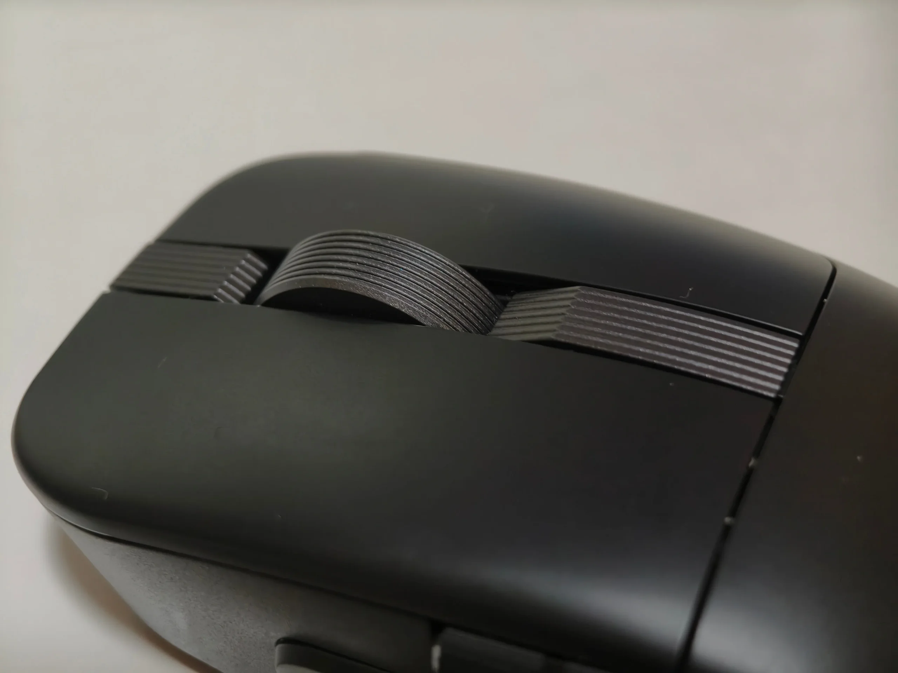
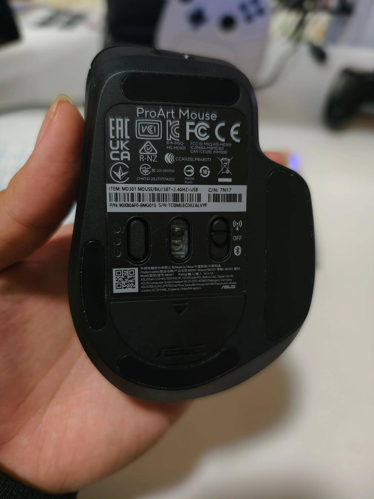
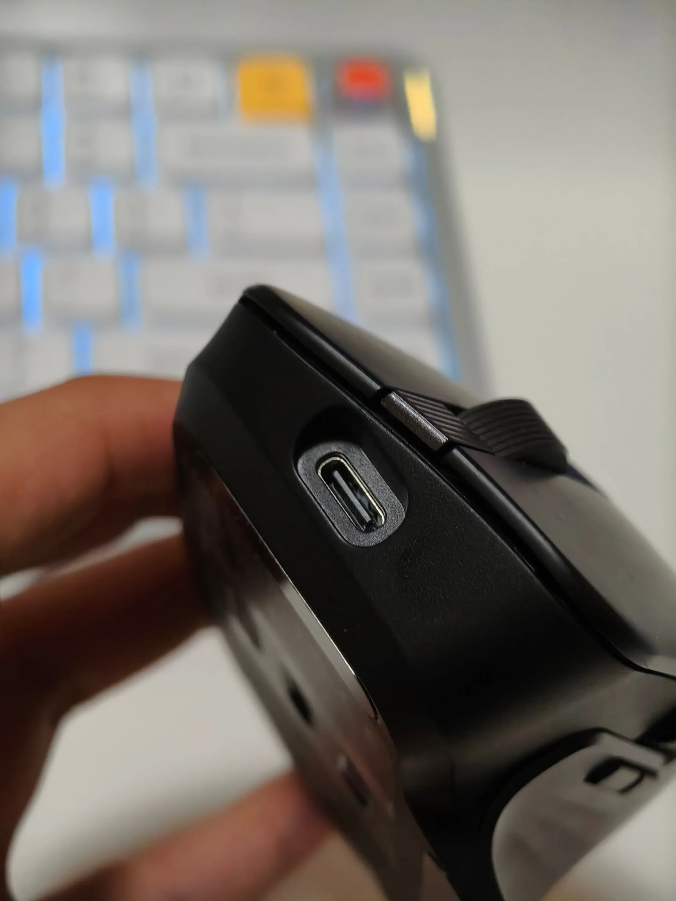
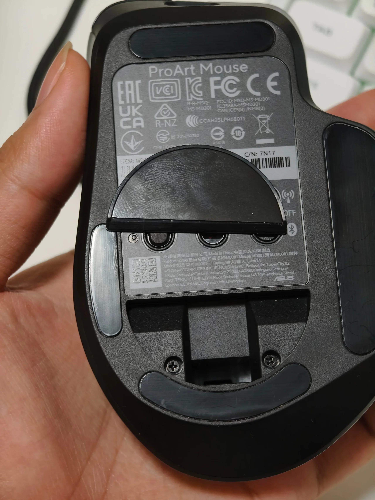

以下是我拍摄的简要开箱和测评视频，内容与本文不同。
[视频](https://www.bilibili.com/video/BV14vftBuE2M/)

## 前言

说实话，我觉得大厂真的烂完了，我买了罗技的 MX Master 3s，这玩意居然离了网络就废了，原因是它没有板载配置，若是没有网络，Logi Options+ 就无法启动，前段时间罗技的证书过期了，导致我一整天只能用鼠标的残废功能，这是我实在不能忍受的，于是在新鼠标出来后，我立刻买来试试了。

现在实际上也有一些可选的其他鼠标，例如渴创M6大师系列，渴创代工的京造M5, 雷蛇的ProClick和一个忘记叫什么的游戏鼠标。不过渴创在 bilibili 上的评价往往是模具不太合适，而雷蛇在我看来和罗技是一丘之貉，我记得在几年前我用雷蛇鼠标的时候，玩游戏时它驱动的弹窗把我打断了，因此我不打算买这两家。

## 体验如何呢

说回正题，这个鼠标如何呢？

说实话，我觉得手感是很不错的，我也懒得多写了，写个列表看个大概吧：

**特点**

- 磨砂手感而不是类肤材质
- 滚轮的纹路竖向
- 横向滚轮阻尼更大（相比master3s）

**优点**

- 有接收器收纳仓（master3s没有）
- 滚轮手感好（类似master3s）
- 有无级滚轮自动切换
- 比较轻（相比master3s）
- 无线回报率1000hz（master3s只有250）

**缺点**

- 无级滚轮向上需要更用力触发
- 无级滚轮能滚动时间更少（相比master3s）
- macOS上驱动功能残缺，虽说它本来也没比罗技强多少

## 其他图片

