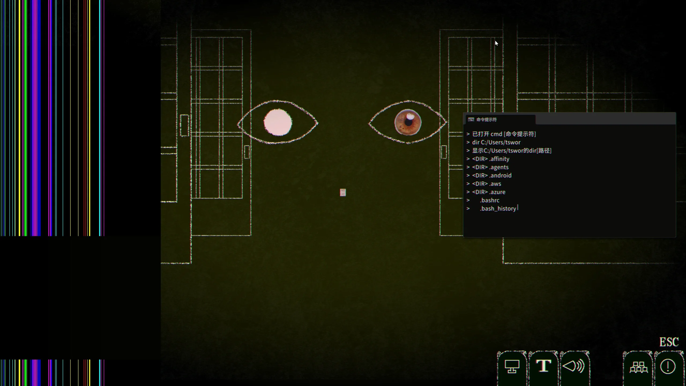

> 下面是睡前临时写的初印象
> 
>

- 对双拼用户不友好，虽然游戏内给的时间非常充裕，但是打全拼总是错字，建议支持双拼方案（
- Demo 中流程一本道，我无法做出选择，所以无法评价游戏的分支设计
- 目前剧情几乎没有展开，也就无从提是否吸引人了，玩法方面在demo中也没有特别有趣的亮点，可能是因为demo的内容比较有限，期待正式版能有更多的内容和亮点

## 初印象

这个游戏似乎是一个打字游戏，打字同时承担了推进游戏进展（如同生死时速），也承担了和“眼睛”沟通的功能，例如你说“吾辈乃是猫”，除了是为了打出文章的一句话，眼睛也会问你“为什么要撒谎”，这个设定乍一看很有趣，但是实际上存在很多meta游戏的一个通病：强行谴责玩家，让我想起了《你和她和她的恋爱》中的剧情安排。

在demo中，我们还会有执行`sudo rm -rf /`的情节（值得一提的是，现实中不要执行这个命令），对于一些人可能会觉得比较有趣，不过我对此无感。
