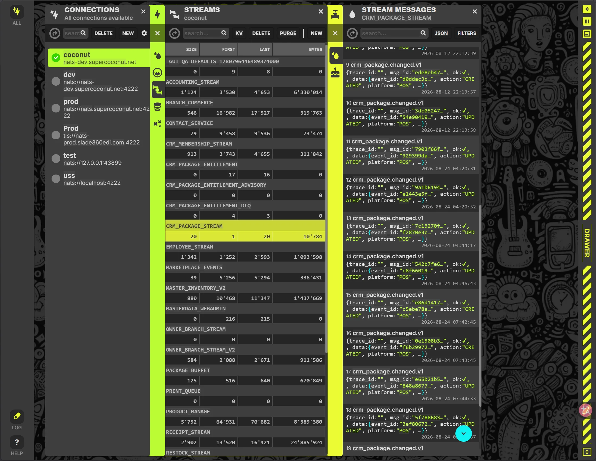
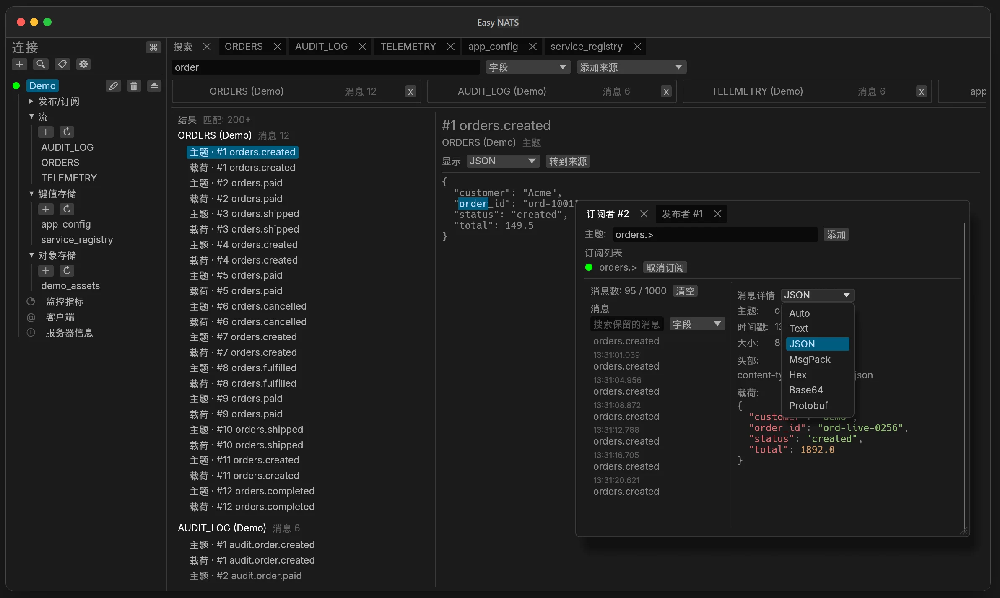

- 源码：[GitHub](https://github.com/mcthesw/easy-nats)
- 网页体验：[基于WASM的小Demo](https://easy-nats.sworld.club)
- 系统与安装方式
  - Windows：Scoop
  - macOS：homebrew
  - Linux：Flatpak（Flathub）、apt、rpm、appimage
  - 或者你可以尝试自己构建？

---

本软件诞生自我工作的需要，因为新的架构选型的时候，团队小伙伴推荐了[Nats](../not-public)来作为我们系统的消息队列，为了方便地浏览消息、消费者或者kv，我们用了很长一段时间的[NUI](https://natsnui.app)，它是一个很不错的工具，但是是基于网页技术的，且操作不太符合我们自己的习惯，于是最终我决定自己造一套（下图是NUI）。

我们团队当时的构成可能是70%的[Rust](../not-public)，剩下的是[Golang](../not-public)，我个人对Rust比较熟，当时刚好对[Tauri](../2026/11/c835cd44)印象非常不好，因此决定试试[egui](../2026/11/0fccae3d)（虽说短暂考虑过[GPUI](../not-public)，不过当时我认为它和[Zed](../not-public)绑得太死了），况且egui有一些很好用的库，于是 EasyNats 诞生了：

我个人觉得多Tab+左栏+可选独立窗口导航真的太适合这种和大量数据打交道的程序了，浏览器、文件管理器基本上都是这一套，很自然就形成了这样的软件布局。

本软件也是我探索全AI开发的第一个尝试，意思是我只做技术选型、架构设计、产品设计和重要部分的review，在较短的时间做出来的成果让我非常满意了，尤其是搜索功能解决了我们之前很烦琐的操作（见上图），不过也可能是因为本项目是一个定义明确、范围极窄的小型软件，因此复杂度没有失控。
