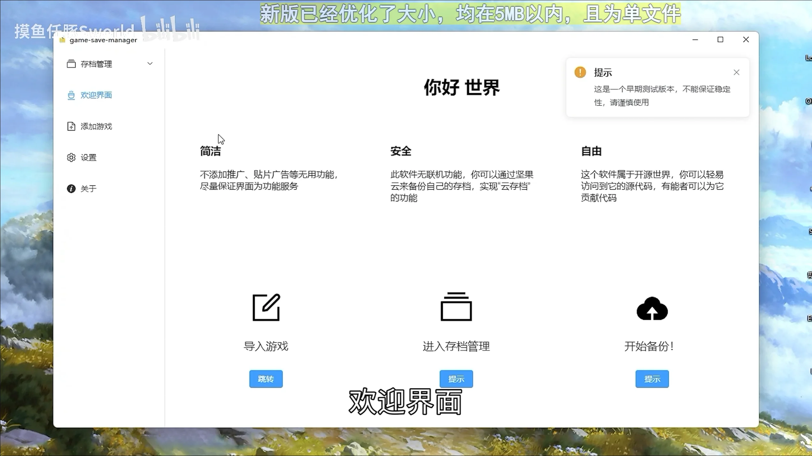
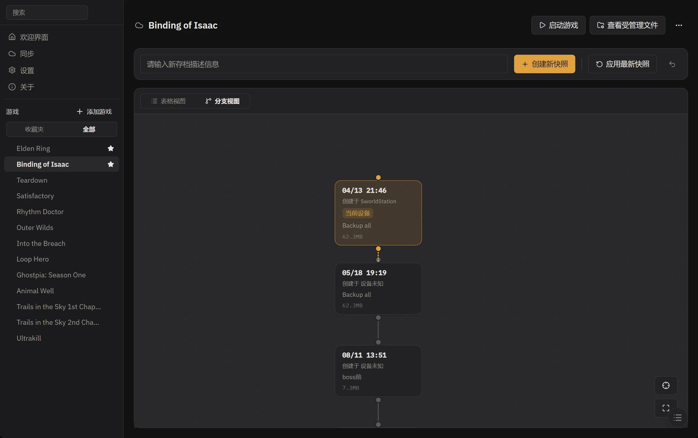
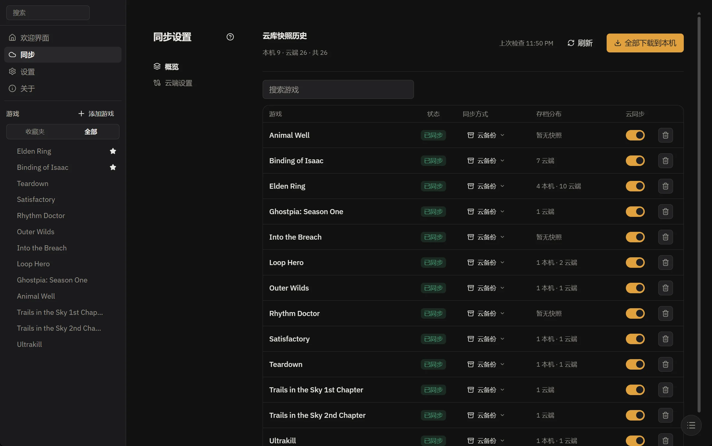

- 源码：[GitHub](https://github.com/mcthesw/game-save-manager)
- 系统与安装方式
  - 目前只支持windows便携版或安装包
  - 其他系统虽然打包了但是没做适配，无法正常使用

---

我最早的开源项目，来源只是大学时期想要玩[艾尔登法环](../not-public)和室友通过SL刷点卢恩，后续演变成了一个较为完整的桌面软件。它的演变经历过以下阶段：

- `0.0.x`：早期实验阶段
- `0.x.y`：基于[Electron](../not-public)+[Vue](../not-public)+Element Plus的一套基本桌面软件，也是在此时制作了[宣传视频](https://www.bilibili.com/video/BV1Zu411q7W1/)
- `1.0.0`-`1.7.0`：使用[Rust](../not-public)+[Tauri](../2026/11/c835cd44)进行重构，迈入了稳定性增强的新阶段，切换为了[Nuxt.js](../not-public)
- `1.8.0+`：着重优化了云端，并在`1.9.0`之后大幅度优化了界面，精简了前端代码，去掉了[Nuxt.js](../not-public)的依赖

总之这个项目作为我开源的第一步，我希望能够尽量久地去维护它，但是在我愈发少使用的情况下，我有点怀疑该项目未来是否会脱离我的掌控变得难以维护了。

好消息是新的存档工具也都做的很不错，各有特色。
