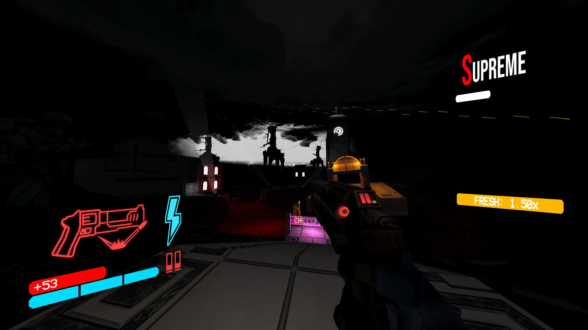
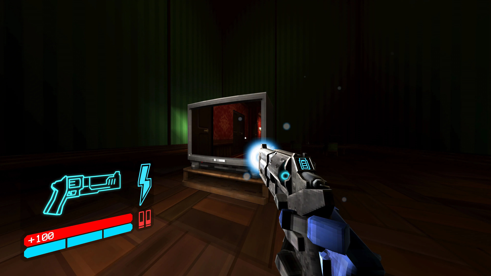
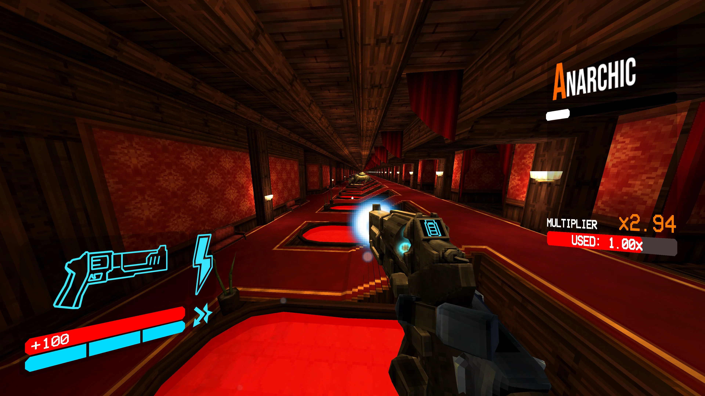
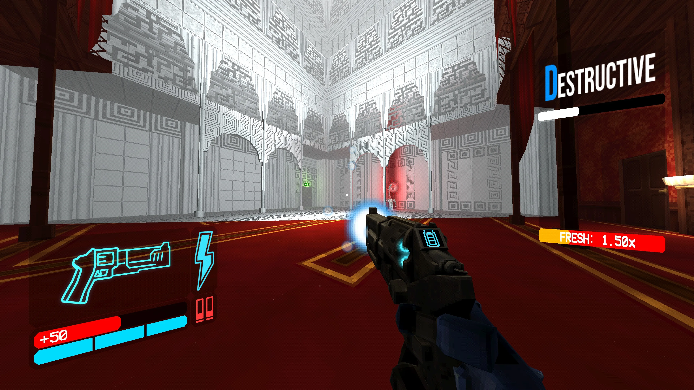
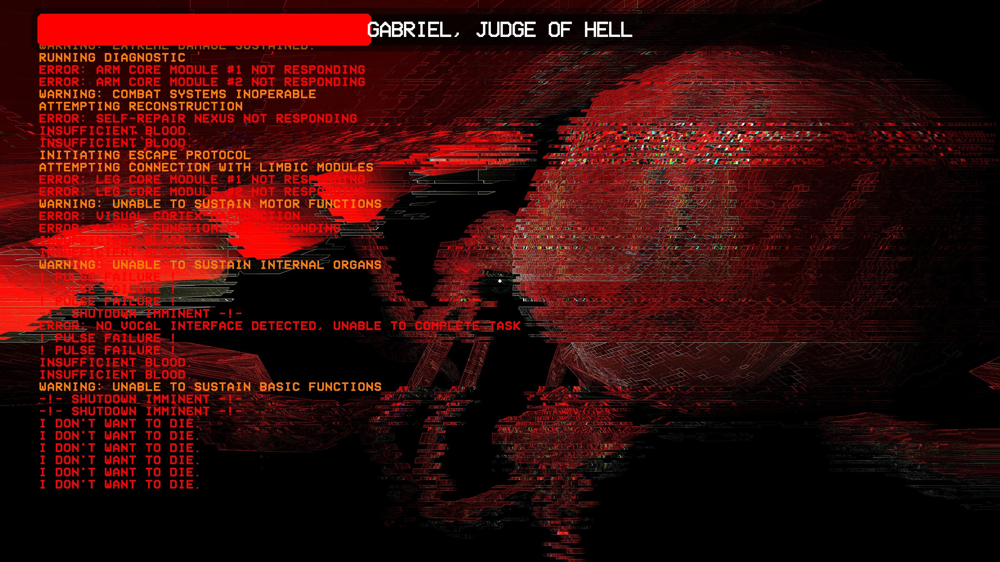
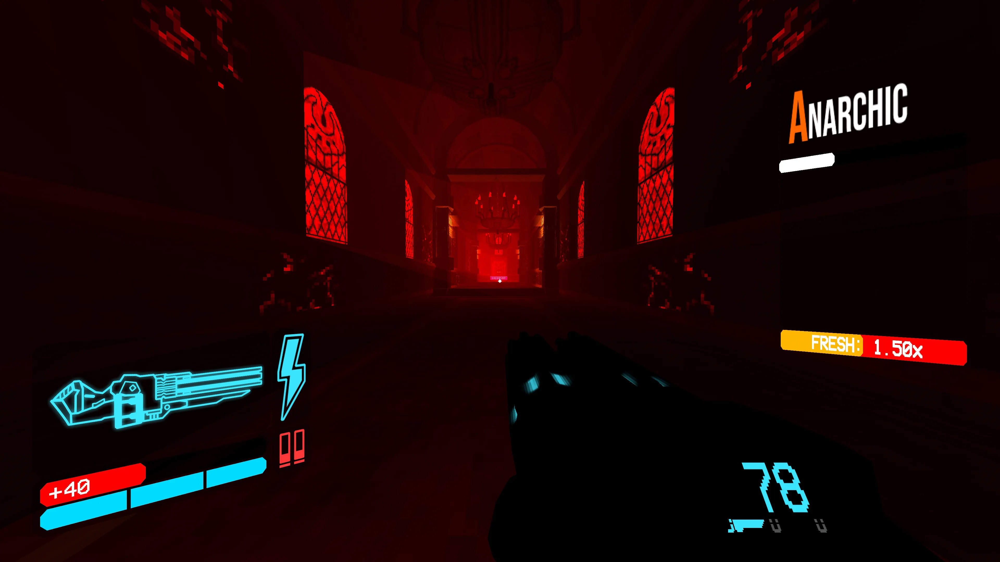
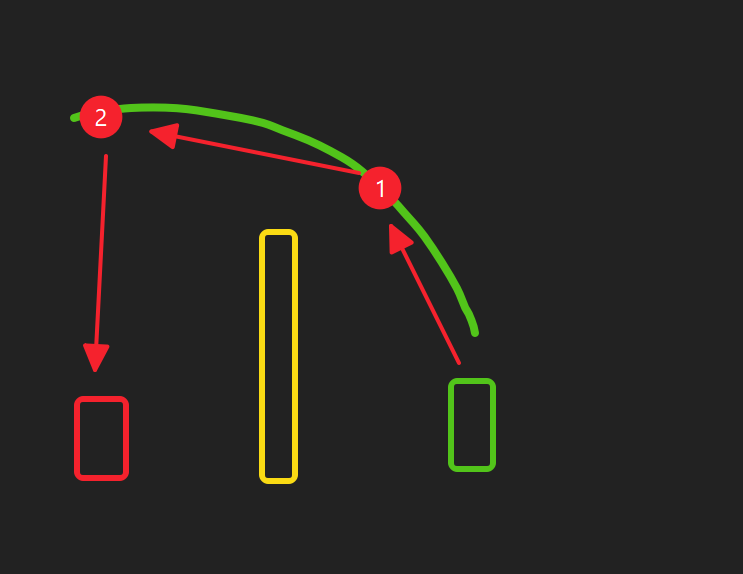

<!-- more -->

## 开端

今年打完毁灭战士黑暗纪元后，我又想试试复古FPS了，在看了下面这个视频后，我火速购入Dusk并通关，这个游戏本身很不错，而且我还有点意犹未尽，一看steam家庭库有bilibili里面评价颇高的Ultrakill，就下载下来体验了！

@[bilibili](BV1vS4y1A7Cu)

## 初见

刚开始玩我的预期其实没多高，我感觉他能让我爽杀一波就ok了，第一关给我的感觉主要就是手感真不错，居然有一个像是鬼泣一样的评分系统，有点意思。

中间的记忆已经有点模糊了，我只记得火箭筒需要精确命中才会产生伤害让我当时有点迷惑，另外每个章节差别都很大，玩起来体验很丰富，我印象最深刻的是有一章节的背景中，一只机械战争巨兽不断释放灭世一般威力的激光，点亮了天空和地图，而在后面几关，直接变成了我们攀登上了它并尝试击败！

另外就是第八章，大量运用了重力翻转、非欧空间、房间结构变换等，有的房间让我感觉仿佛是同时在两个时空作战（既有\*分时并发\*，也有通过位置调整来攻击不同空间中敌人的设计），玩起来是有点晕，但是非常新奇。

## 再发掘

一周目如此爽杀通关了，然而到此时，我其实还不知道蓝拳可以弹反，实际上在这几天，我重新捡起来玩并看了几个教程后，才发现它的深度远不止我之前玩到的，因此这几天又想要在残酷难度看看能不能打全P评价了，不过目前对我来说还是有点太难了，于是我在沙盒苦练几个技能，然后到血宫去爽了！

不过先不说那些只有玩过的人才懂的东西，我想用几个例子来说明它的深度：

游戏中有一个很有趣的武器（可能是我使用时间最长的），就是这把手枪，右键会让角色抛出一枚硬币，而如果你击中硬币，可以让它自动射向敌人的弱点，如果时机合适，可以分裂成两个子弹，而子弹会优先攻击其他硬币，这样我们就能做到一套连锁反应，例如这样来攻击视线外的敌人

<figure>
  
  <figcaption>图1：绿色是硬币运动路径，数字对应先后被击中的硬币，红色是子弹路径</figcaption>
</figure>

除此之外，我们也可以抛出多个硬币，使用轨道炮或者蓄力手枪击中它来获得更高的伤害。硬币本身也可以用来反射敌人的射线类攻击，这稍微有点考验时机，我感觉在实战中用出来还是很有难度的。另外，某些敌人也会抛出硬币，如果你能在他们之前击中他们的硬币，就能造成伤害！

而弹反更是爽飞，既可以弹反敌人的各种飞弹（我感觉上是比较像是球形的都可以弹），也可以在自己的霰弹枪发射的瞬间弹反自己，这样射出的子弹就会附有爆炸，还可以弹反自己射出去正在收回的电锯，一些强怪的近战攻击也是可以弹反的（让我想起了毁灭战士黑暗纪元），打起来交互感很强啊，敌人的很多攻击方式我们都有招架方式。

还有很多高阶技巧，例如使用导弹+气锤来发射红爆榴弹、用电来灌伤害、如何利用气锤或导弹来快速移动……我感觉这游戏的搓招和可玩性太强了！

这几天我在血宫鏖战真的是久违地进入心流了，感觉着实不易，故留此文纪念
